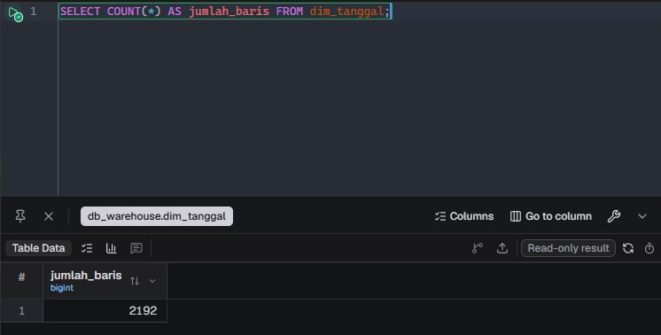
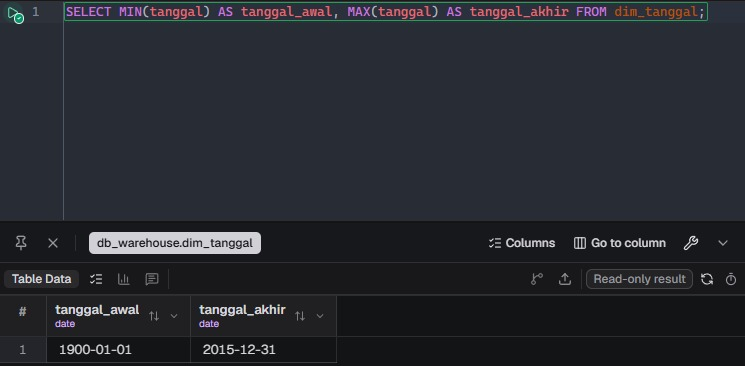
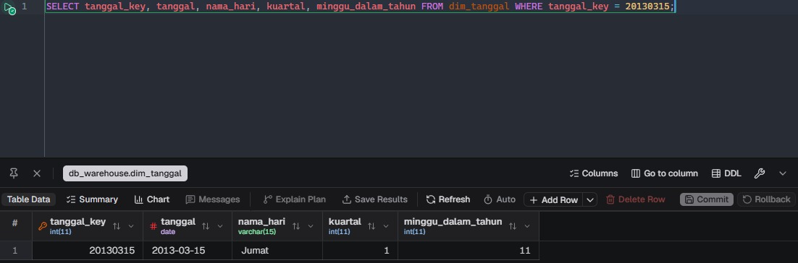

# Bukti Tes `dim_tanggal`

## Kode SQL
SELECT COUNT(*) AS jumlah_baris 
FROM dim_tanggal;

SELECT MIN(tanggal) AS tanggal_awal, MAX(tanggal) AS tanggal_akhir 
FROM dim_tanggal;

SELECT tanggal_key, tanggal, nama_hari, kuartal, minggu_dalam_tahun 
FROM dim_tanggal 
WHERE tanggal_key = 20130315;

---

## Bukti Tes

##Tes 1

##Tes 2

##Tes 3
