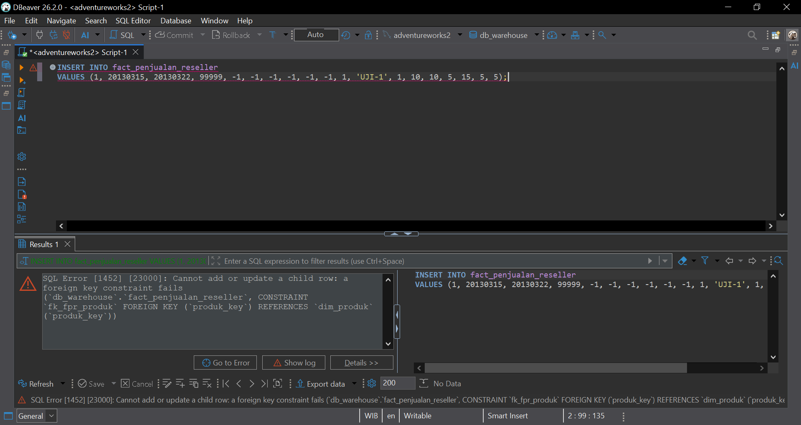
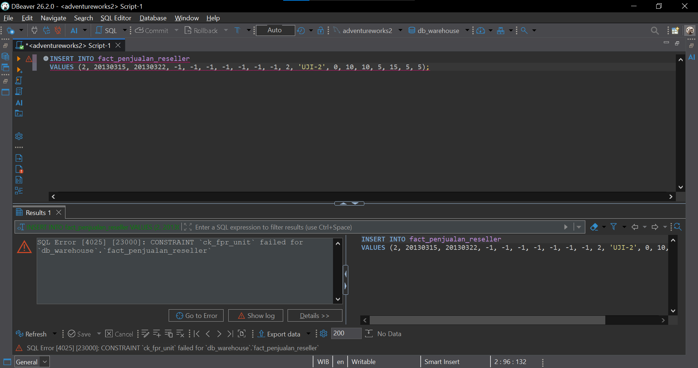
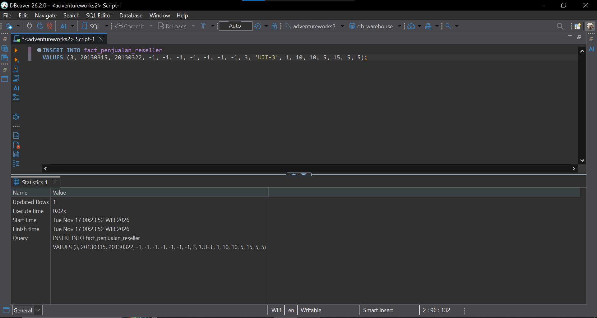
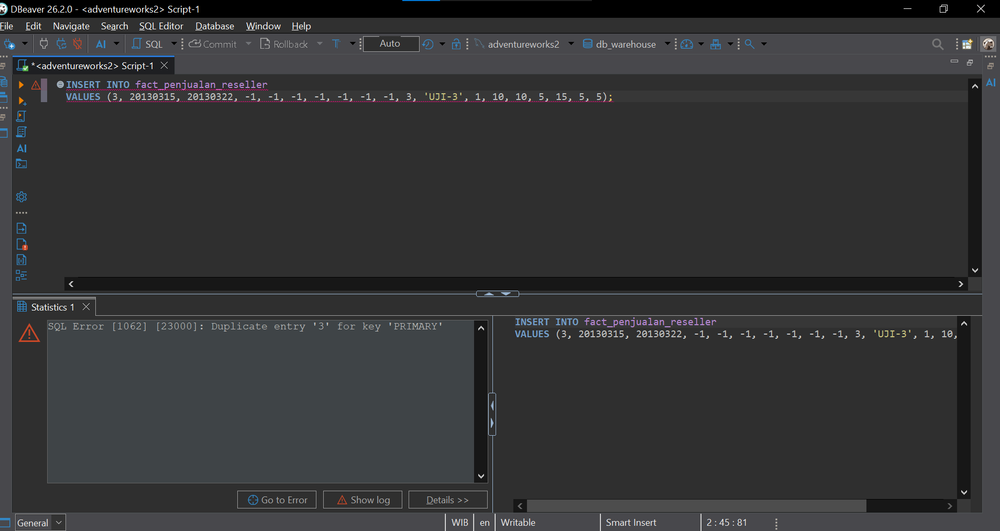

-- Uji 1: foreign key. Produk dengan key 99999 tidak ada di dim_produk.
INSERT INTO fact_penjualan_reseller
VALUES (1, 20130315, 20130322, 99999, -1, -1, -1, -1, -1, -1, 1, 'UJI-1', 1, 10, 10, 5, 15, 5, 5);

-- Uji 2: check. Jumlah unit nol tidak masuk akal (melanggar ck_fpr_unit: jumlah_unit > 0).
INSERT INTO fact_penjualan_reseller
VALUES (2, 20130315, 20130322, -1, -1, -1, -1, -1, -1, -1, 2, 'UJI-2', 0, 10, 10, 5, 15, 5, 5);

-- Uji 3: primary key. Jalankan dua kali, yang kedua harus gagal karena fakta_penjualan_key = 3 sudah ada.
INSERT INTO fact_penjualan_reseller
VALUES (3, 20130315, 20130322, -1, -1, -1, -1, -1, -1, -1, 3, 'UJI-3', 1, 10, 10, 5, 15, 5, 5);

